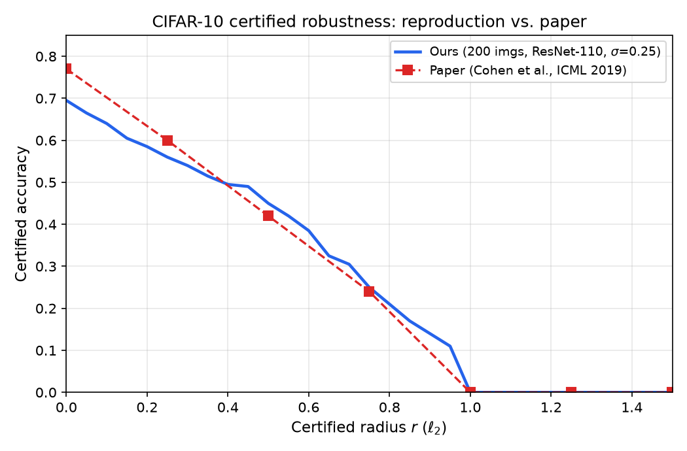

# 随机平滑认证鲁棒性复现

《Certified Adversarial Robustness via Randomized Smoothing》(ICML 2019) 的课程复现项目，
属于「可信人工智能」课程报告的一部分。

## 论文信息

- **标题**：Certified Adversarial Robustness via Randomized Smoothing
- **作者**：Jeremy Cohen, Elan Rosenfeld, J. Zico Kolter (CMU / Bosch Center for AI)
- **会议**：ICML 2019
- **原文**：https://arxiv.org/abs/1902.02918
- **原始代码**：https://github.com/locuslab/smoothing

## 复现内容

论文的主要实验是：在 CIFAR-10 上用高斯数据增强训练 ResNet-110，
再通过蒙特卡洛认证算法计算分类器在不同 ℓ2 半径下的**认证准确率**。

本仓库复现的是 **σ = 0.25 的主实验曲线**：

| 认证半径 r | 本复现 | 论文报告 |
| --- | --- | --- |
| 0.00 | 0.695 | 0.77 |
| 0.25 | 0.560 | 0.60 |
| 0.50 | 0.450 | 0.42 |
| 0.75 | 0.250 | 0.24 |
| 1.00 | 0.000 | 0.00 |

辅助指标：弃权率 10.5%，正确样本的平均认证半径 0.587。



## 环境

- Windows 11 / Python 3.13.5
- PyTorch 2.14.1 + CUDA 12.6
- GPU：NVIDIA RTX 3060 Laptop（6 GB）

```bash
python -m venv .venv
.venv\Scripts\activate
pip install -r requirements.txt
```

## 运行

1. 下载作者提供的预训练模型，解压到仓库根目录，形成 `models/` 目录
2. 首次运行会自动下载 CIFAR-10 到 `dataset_cache/`
3. 执行认证：

```bash
python code/certify.py cifar10 models/cifar10/resnet110/noise_0.25/checkpoint.pth.tar 0.25 results/out.txt --skip 50 --batch 400
```

`--skip 50` 表示每 50 张测试图认证 1 张，共 200 张；单张约 21 秒，全部约 66 分钟。

## 与原文的差异

本项目在复现过程中做出了以下调整，均已在报告中说明：

1. **Windows 兼容性补丁**（`code/` 目录）
   - 原文 `certify.py` / `predict.py` 依赖 `setGPU`，该包仅支持 Linux，
     本项目提供了空实现的 `code/setGPU.py` 以保持上游代码不改动。
   - 原文使用 `scipy.stats.binom_test`，该函数在 SciPy ≥ 1.11 中已被移除，
     本项目在 `code/core.py` 中加入了向后兼容的包装。
2. **样本量**：原文认证 500 张（`--skip 20`），本复现为 200 张（`--skip 50`），
   以适配课程作业的时间预算；200 张下比例估计的标准误约为 ±0.032。
3. **硬件**：原文在服务器级 GPU 上完成，本复现在单卡 RTX 3060 Laptop 上运行，
   batch size 沿用原文的 400（实测显存占用仅约 150 MB）。

## 目录结构

```
.
├── code/                  # 论文原始代码（含两处 Windows 兼容补丁）
├── data/                  # 原作者提供的原始实验结果（未使用，供对照）
├── figures/               # 本复现生成的图
├── results/               # 本复现的认证输出
├── docs/comparison.md     # 与论文的逐点对比
└── requirements.txt
```

## 引用

若使用本仓库代码，请引用原论文：

```
@inproceedings{cohen2019certified,
  title={Certified Adversarial Robustness via Randomized Smoothing},
  author={Cohen, Jeremy and Rosenfeld, Elan and Kolter, J. Zico},
  booktitle={International Conference on Machine Learning},
  year={2019}
}
```

原始代码版权归原作者所有，遵循其仓库中的许可条款。